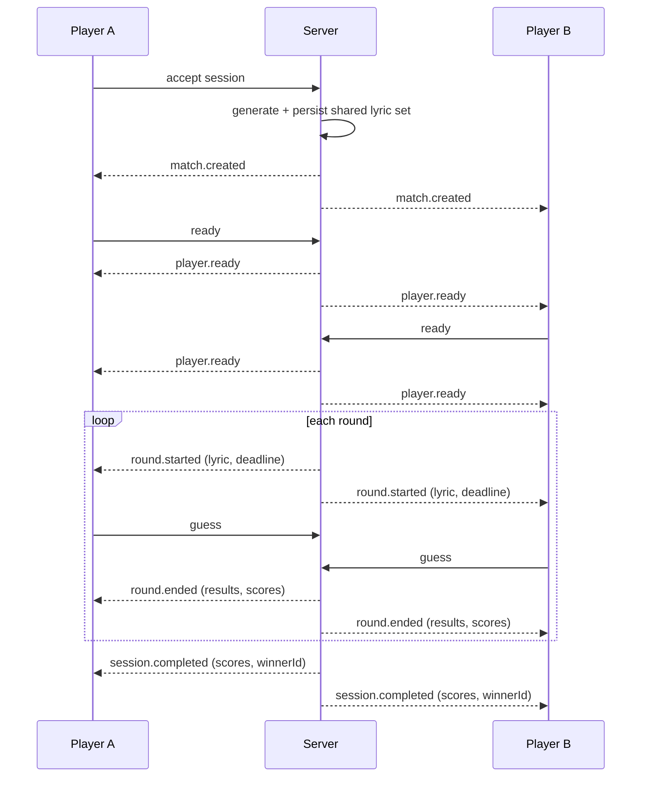
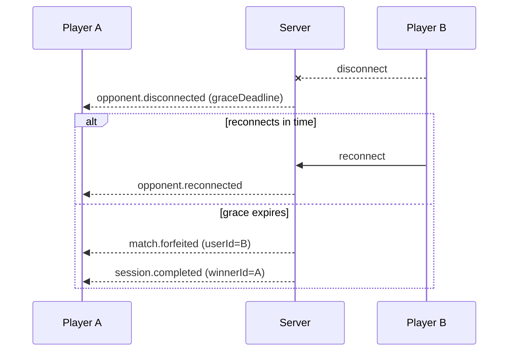

# Realtime Protocol

This document describes the realtime WebSocket protocol served under the `/realtime` namespace. It covers the head-to-head match flow introduced for issue #335: shared lyric sets, ready handshakes, synchronised rounds, live scores, disconnects, timeouts, and restart recovery.

## Connection

Clients connect to the `/realtime` namespace and authenticate with their session token. After authentication the server associates the socket with the player's `userId` and any active `sessionId`.

## Match lifecycle

A head-to-head match is created when a head-to-head session is accepted. The server then drives the match through a fixed sequence of events so that both clients observe the same state.

### Events (server → client)

| Event | Payload | Description |
| --- | --- | --- |
| `match.created` | `{ sessionId, players, totalRounds }` | Emitted on accept. A shared ordered lyric set has been generated and persisted. |
| `player.ready` | `{ sessionId, userId }` | Broadcast when a player sends `ready`. |
| `round.started` | `{ sessionId, round, lyric, deadline }` | Sent to both players with the same lyric and the same absolute `deadline` (ISO timestamp). |
| `round.ended` | `{ sessionId, round, results }` | Sent to both players with each player's guess outcome and updated scores. |
| `session.completed` | `{ sessionId, scores, winnerId }` | Emitted after the last round. Triggers wager settlement (see issue 40). |
| `opponent.disconnected` | `{ sessionId, userId, graceDeadline }` | The opponent dropped; a grace period is running. |
| `opponent.reconnected` | `{ sessionId, userId }` | The opponent reconnected within the grace period. |
| `match.forfeited` | `{ sessionId, userId, reason }` | A player forfeited (disconnect grace expired or round timeout). |
| `match.aborted` | `{ sessionId, reason }` | The match was cleanly aborted (e.g. server restart could not resume). Wagers are refunded. |

### Events (client → server)

| Event | Payload | Description |
| --- | --- | --- |
| `ready` | `{ sessionId }` | Player signals readiness. The first round starts once both players are ready. |
| `guess` | `{ sessionId, round, guess }` | Submit a guess for the current round. |
| `reconnect` | `{ sessionId }` | Re-attach to an in-progress match after a disconnect. |

## Round flow

1. On accept, the server generates a shared ordered lyric set and persists it with the session.
2. Each player emits `ready`. When both are ready, the server starts round 1.
3. For each round the server emits `round.started` to both players with the same lyric and the same `deadline`.
4. Guesses are collected until both players have guessed or the deadline passes.
5. The server emits `round.ended` with both results and updated scores.
6. Steps 3–5 repeat for each lyric in the set.
7. After the last round the server emits `session.completed`.

## Disconnects and timeouts

- **Disconnect:** when a player disconnects mid-match, the server emits `opponent.disconnected` and starts a grace period. If the player reconnects and emits `reconnect` before the grace period expires, the server emits `opponent.reconnected` and the match continues. If the grace period expires, the server emits `match.forfeited` and completes the session in favour of the remaining player.
- **Round timeout:** if a player does not guess before the round `deadline`, the round ends with that player's guess treated as a miss. A player who misses every round deadline forfeits.

## Restart recovery

Match state (shared lyric set, current round, per-round results, scores, ready flags, and deadlines) is persisted so that a server restart mid-match can either resume the match from the last completed round or cleanly abort it. On abort the server emits `match.aborted` and refunds any wagers associated with the session.

## Sequence diagram

### Disconnect / forfeit

